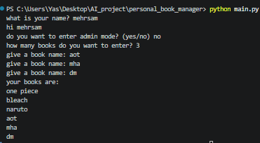
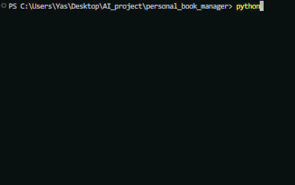

# Personal Book Manager


A command-line book manager built with Python. It lets you enter book titles, display the saved collection, and store the collection in a JSON file.

## Features

- Ask for the user's name and greet them.
- Optionally enter Admin Mode by providing the configured password.
- Add multiple book titles in one run.
- Display all books in the collection.
- Save the collection to `books.json`.
- Load previously saved books when the program runs again.

## Project Structure

```text
Personal-Book-Manager/
│
├── main.py
├── books.py
├── books.json
├── .env.example
├── .gitignore
├── requirements.txt
├── README.md
│
└── images/
    ├── screenshot.png
    └── demo.gif
```

- `main.py` — The main entry point of the program. It handles the user's name, Admin Mode password check, and calls the book management functions.
- `books.py` — Contains the functions for adding books, displaying books, loading saved books, and saving books.
- `books.json` — Stores the book collection in JSON format. It is created when the program saves the books.
- `.env.example` — Provides a template showing which environment variable is needed for Admin Mode.
- `.gitignore` — Specifies files that Git should ignore, such as `.env`, `books.json`, log files, and Python cache files.
- `requirements.txt` — Contains the external Python packages required by the project.
- `README.md` — Introduces the project and explains how to install and run it.
- `images/` — Contains screenshots and GIFs used to demonstrate the project.

## Requirements

- Python 3.12
- `python-dotenv`

The `os` and `json` modules are part of Python's standard library and do not need to be installed separately.

## Installation

Install the required packages from `requirements.txt`:

```bash
python -m pip install -r requirements.txt
```

## Environment Setup

1. Create a file named `.env` inside the project folder.
2. Use `.env.example` as a template to see which environment variables are required.
3. Copy the contents of `.env.example` into `.env`.
4. Replace the example password with a password of your choice.

Example `.env` content:

```dotenv
BOOK_MANAGER_ADMIN_PASSWORD=your_password
```

Keep `.env` private and **do not upload it to GitHub**.

The `.env.example` file should be included in the repository because it is a template for other users. It should contain only an example password, not your real password.

## Run the Program

The main program file is `main.py`. From the project root, run:

```bash
python main.py
```

Follow the prompts in the terminal to enter your name, optionally activate Admin Mode, and add books.

## How It Works

1. **User Information:** The program starts by asking for the user's name and greeting them.
2. **Admin Mode:** The user can choose whether to enter Admin Mode. If they choose yes, the program asks for a password and checks it against the password stored in `.env`.
3. **Load Previous Books:** The program loads previously saved books from `books.json`. If the file does not exist, it starts with an empty list.
4. **Add New Books:** The program asks how many books the user wants to enter and then asks for each book's name.
5. **Display Books:** After entering the books, the program displays all books in the collection, including previously saved books.
6. **Save Books:** Finally, the program saves the updated book collection into `books.json` so it can be loaded the next time the program runs.

## Screenshot



## Demo



## Troubleshooting

### 1. FileNotFoundError

**What does it mean?**

Python cannot find a file that the program is trying to open.

**Why might it happen?**

The program may be running from the wrong directory, or a required file may be missing.

**What should I check first?**

Check that you are running `main.py` from the project root directory. Also check that the required files are in the correct locations.

Note: If `books.json` does not exist on the first run, the program already handles this situation by starting with an empty list.

### 2. JSONDecodeError

**What does it mean?**

Python cannot read the contents of `books.json` because the JSON data is invalid.

**Why might it happen?**

The file might be empty or contain incorrectly formatted JSON.

**What should I check first?**

Open `books.json` and check whether its contents are valid JSON. Also check whether the file was accidentally edited or damaged.

### 3. ModuleNotFoundError: No module named 'dotenv'

**What does it mean?**

Python cannot find the `python-dotenv` package.

**Why might it happen?**

The package may not have been installed, or it may have been installed in a different Python environment.

**What should I check first?**

Check that the correct Python environment is active and install the requirements again:

```bash
python -m pip install -r requirements.txt
```

### 4. Admin Password Not Working

**What does it mean?**

The password entered in the terminal does not match the password loaded from `.env`.

**Why might it happen?**

The `.env` file may be missing, the variable name may be incorrect, or the password may not match the value stored in the file.

**What should I check first?**

Check that the `.env` file is in the project root and that the variable name is exactly:

```dotenv
BOOK_MANAGER_ADMIN_PASSWORD=your_password
```

Make sure the password you enter matches the value stored in `.env`.